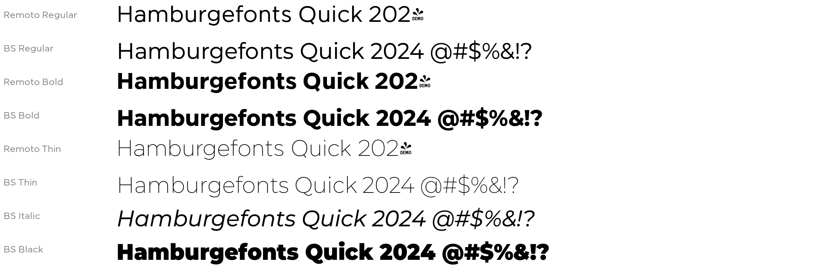

# Remoto BS

A Remoto-style geometric sans for Canva, with all numbers and symbols included.

Built from [Montserrat](https://github.com/JulietaUla/Montserrat) (SIL Open Font License 1.1). Each weight is tuned to match Remoto's stroke thickness and letter width. No outlines are taken from Remoto.

**Styles:** Thin, Light, Regular, Medium, Bold, Black, each with an italic (12 files).

## Use in Canva
Brand → Brand Kit → Fonts → **Upload a font**, then select all `.ttf` files. (Uploading custom fonts needs Canva Pro.)

## Rebuild
`tools/build.py` makes the fonts from the Montserrat variable fonts (`pip install fonttools`).

License: SIL OFL 1.1, see `OFL.txt`.
